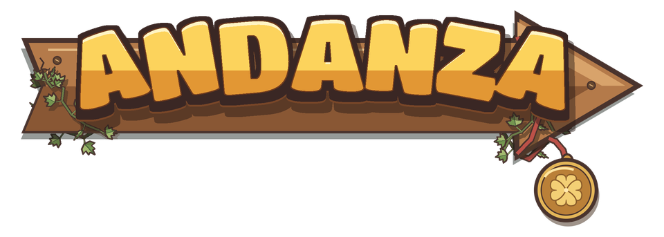
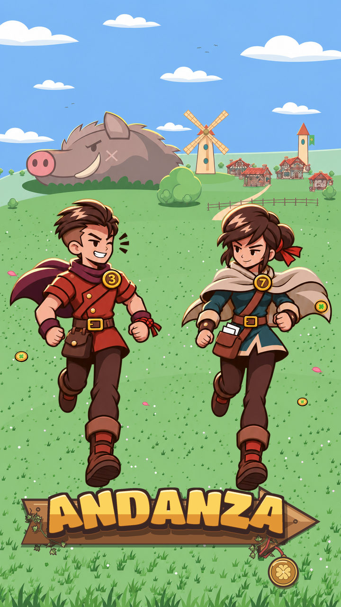
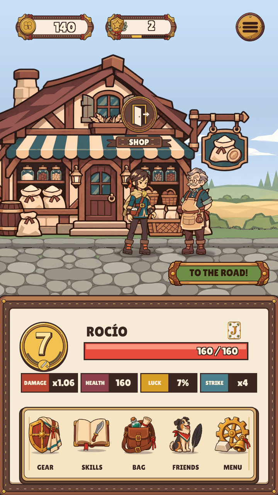
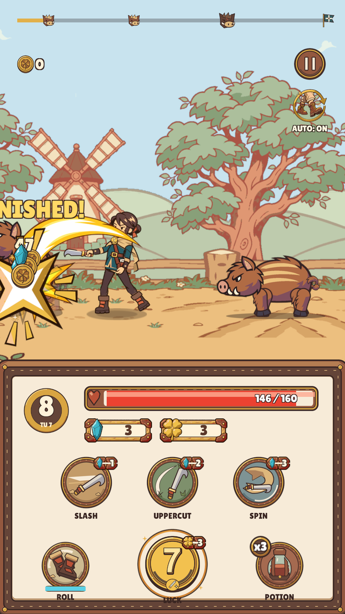
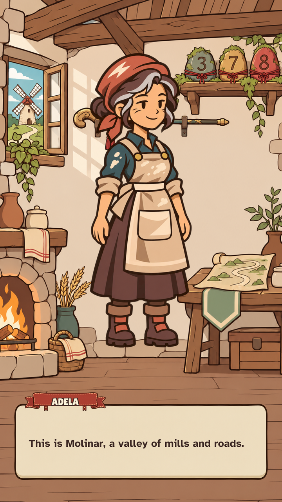
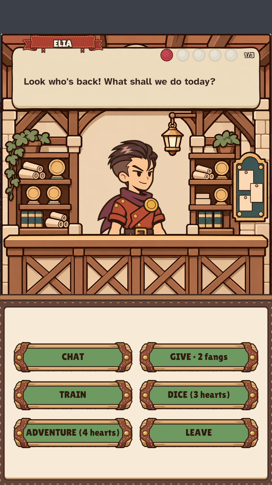
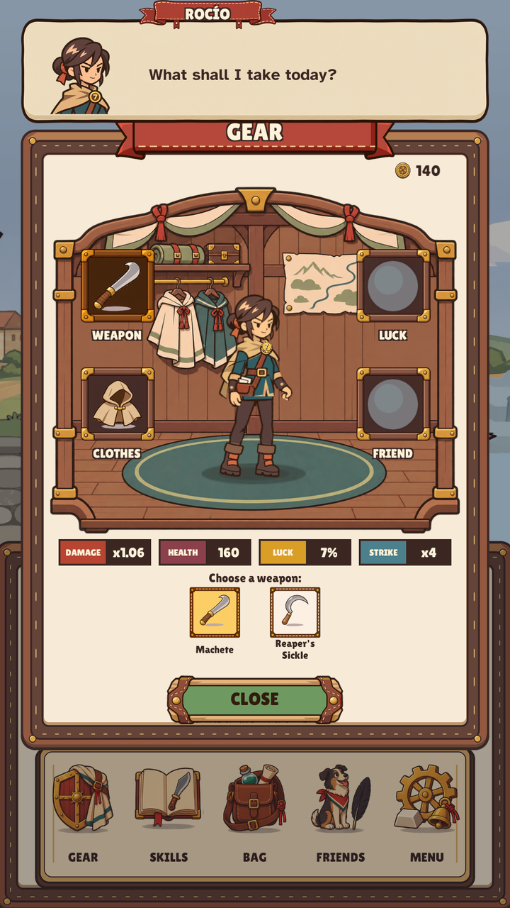

  

<h3 align="center">Espera tu número. Golpea con suerte.</h3>

  RPG de acción vertical para celular y navegador donde tu número de la suerte decide cómo peleas, qué compras y cómo creces.

  <a href="https://github.com/jorshuadev/andanza/releases/latest"><b>Descargar</b></a> ·
  <a href="https://jorshuadev.itch.io/andanza"><b>Jugar en el navegador (itch.io)</b></a>

---

  
  
  

  
  
  

## De qué trata

Te toca ser **Andante**: recorrer los caminos del valle para mantenerlos abiertos. Recibes tu licencia, eliges con quién viajas y grabas en tu medallón tu **runa de la suerte**: el **3**, el **7** o el **8**.

En combate, cada golpe gira la **ruleta del medallón** (1–10). Cuando sale **tu número**, tus golpes son **golpes de suerte**: pegan mucho más y son lo único que rompe los escudos de las bestias y de los jefes. Si te golpean, la suerte se escapa.

- **3**: sale seguido y recarga tus técnicas.
- **7**: sale poco, pero golpea ×4 y rompe escudos de un golpe.
- **8**: cada golpe de suerte te cura.

Entre misiones vuelves a **Molinar**, una aldea viva: Gremio con encargos, tienda, herrería, posada, peluquería y vecinos con los que charlar. El equipo, la comida y hasta los rangos (J · Q · K · A · Joker) giran alrededor de tu número.

**Contenido:** 5 misiones de rango J y la final de rango Q contra **Colmillo Viejo**, cada una con su jefe. Se juega en **español e inglés**.

## Controles

| Acción | Celular | Teclado |
|---|---|---|
| Atacar (mantener = cargar gemas) | tocar la escena | J / Espacio |
| Técnicas: Tajo · Alzada · Giro | botones | U · I · O |
| SUERTE (abre tu número) | tu medallón | P |
| Rodar · Poción | botones · deslizar = rodar | K · L |
| Caminar · Correr | tocar la calle · doble toque = correr | A/D o ← → |
| Caminar solo | botón AUTO | — |
| Pausa · Créditos | ⏸ / ≡ | Esc |

Las teclas se pueden cambiar dentro del juego, en la aldea.

## Descargar

Todas las versiones están en **[Releases](https://github.com/jorshuadev/andanza/releases/latest)**:

| Archivo | Plataforma |
|---|---|
| `Andanza-v1.1-Android.zip` | Android (APK). Descomprime e instala el `.apk`; puede pedir permitir *orígenes desconocidos*. |
| `Andanza-v1.0-Web.zip` | Versión web (WebGL) de la jam, para alojarla en tu propio servidor. |

Para jugar sin instalar nada, usa la versión del navegador en **[itch.io](https://jorshuadev.itch.io/andanza)** (funciona también en el celular).

## La jam

Hecho para la **Unity Game Jam 2026** ([itch.io/jam/official-unity-game-jam-2026](https://itch.io/jam/official-unity-game-jam-2026)) con el tema **"Lucky Number"**. Sin tu número no funciona nada: no caen los escudos, no mueren los jefes, y el equipo y la comida pierden su sentido.

Motor: **Unity 6**.

## Créditos

- Diseño, dirección y producción: **Jorshua Jiménez**
- Música: "Minstrel Guild", "Celtic Impulse" y "Five Armies" — **Kevin MacLeod** ([incompetech.com](https://incompetech.com)), bajo licencia [Creative Commons Attribution 4.0](http://creativecommons.org/licenses/by/4.0/)
- Tipografías: Lilita One (Juan Montoreano), Atkinson Hyperlegible (Braille Institute), Titan One (Rodrigo Fuenzalida) — SIL Open Font License 1.1
- Efectos de sonido: sintetizados para este juego

Créditos completos dentro del juego (título → CRÉDITOS).

---

© 2026 Jorshua Jiménez. Este repositorio contiene solo la página del juego, capturas y descargas; el código no es público.
